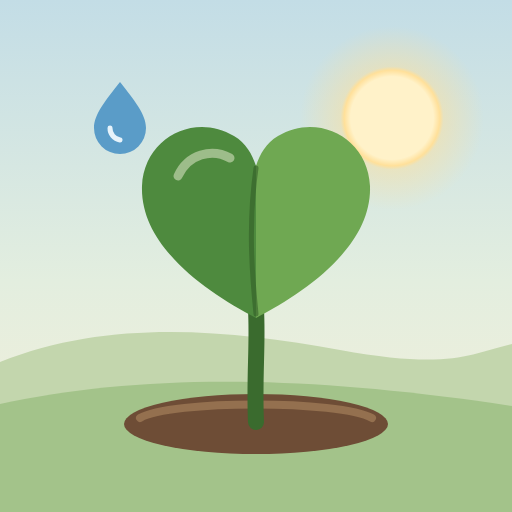
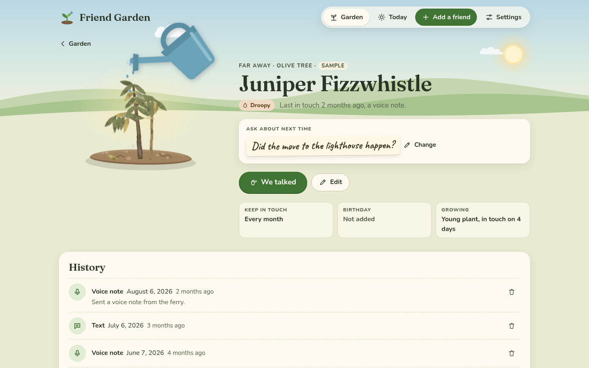
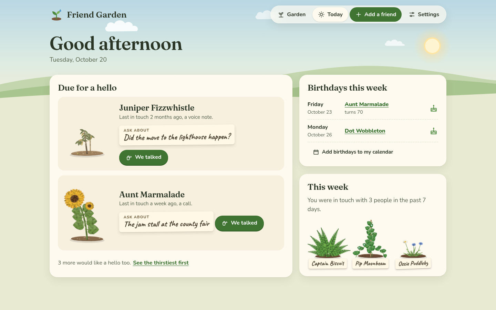
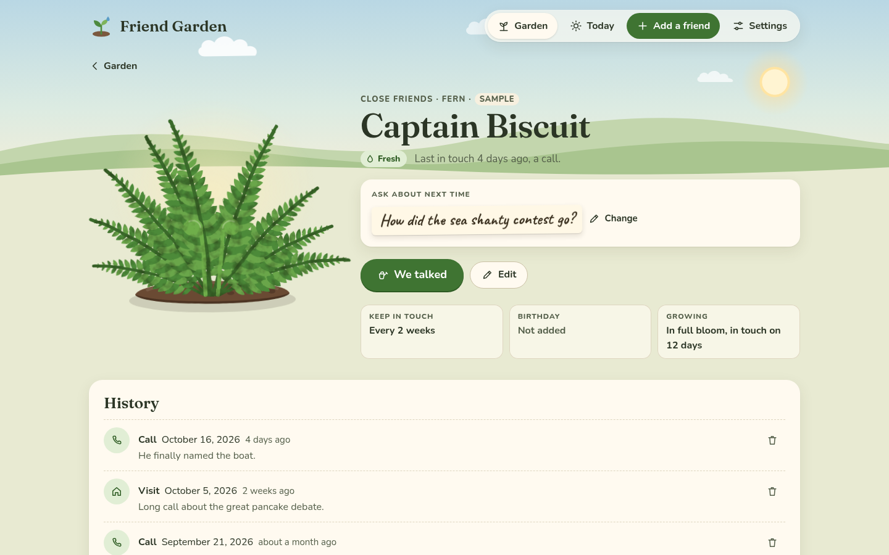
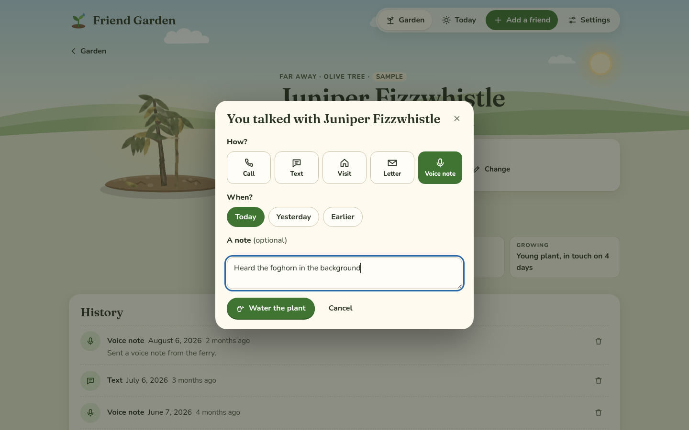
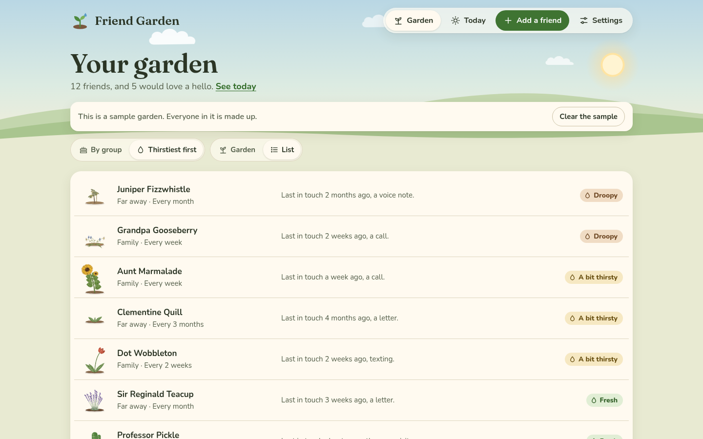
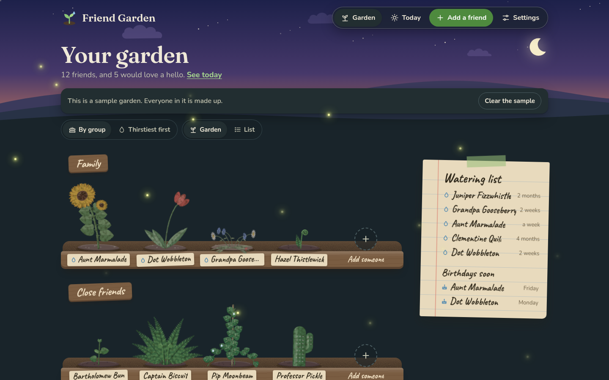

  

<h1 align="center">Friend Garden</h1>

<b>Keep in touch with the people you love: every friend is a plant, and a call is watering it.</b> A small, free web app with no account, and everything stays on your device.

  
  
  
  
  

  <a href="docs/README.md"><b>Docs</b></a> ·
  <a href="#use-it">Use it</a> ·
  <a href="#what-it-does">What it does</a> ·
  <a href="#screenshots">Screenshots</a> ·
  <a href="docs/the-plants.md">The plants</a>

<picture>
  <source media="(prefers-color-scheme: dark)" srcset="docs/images/hero-dark.png">
  
</picture>

Friend Garden is a garden where every friend is a plant. When you get in touch, you water it, and a plant that's
gone a while without water starts to look a little thirsty. It never dies and it never scolds you. It just shows
you who you haven't talked to in a while, and what you wanted to ask them about.

## Why I made it

Most friendships don't end with a fight. They fade quietly, because nobody's counting, and one day you notice it's
been a year since you talked to someone you really like. I wanted something that notices that for me, but gently.

The tools I found for this felt like work: overdue counters, streaks, red badges, a to-do list with people on it.
That's the last thing I want to feel about the people I love. A thirsty plant is different. It doesn't make you
feel guilty, it just looks like it would like a drink, which is exactly the kind of nudge I was after.

So I made a garden instead. It's free, there's no account, and everything you put in it stays in your OWN browser,
which means nobody else ever sees who your friends are. Basically, instead of a list of people you owe a call, you
have a garden to look after.

## What it does

### The garden
- **Every friend is a plant.** Eight kinds, all drawn by hand: fern, tulip, sunflower, pothos, lavender, cactus,
  olive tree and wildflowers. Pick one, or let it pick one that isn't in your garden yet.
- **It grows.** Five stages, from a seedling to full bloom, a step at a time as you keep in touch over the months.
  A plant never shrinks.
- **It gets thirsty.** Each friend has a rhythm (every week, every 2 weeks, every month, every 3 months or
  "whenever"), and the plant goes from fresh to a bit thirsty to droopy as the time since your last hello grows.
- **Beds by group.** Family, Close friends, Far away, or groups of your own, each a wooden planter with a sign.
- **Thirstiest first, or a list.** Sort the whole garden by who's waited longest, or see everyone as a plain list.
- **Day and dusk.** A daytime garden in light mode, and the same garden at dusk, with fireflies, in dark mode.

### Keeping in touch
- **Today.** Two people to say hello to (the one who's waited longest and one more), birthdays in the next week,
  and how many people you were in touch with this week. No streaks and nothing red.
- **We talked.** Log a call, text, visit, letter or voice note, with a note if you like, and then "Anything to ask
  about next time?" A watering can comes out and the plant perks up.
- **Ask about next time.** A little note on each friend's card, so you remember the new job or the trip.
- **History.** Every hello, newest first, with its note.
- **A watering list** pinned beside the garden on wide screens, with who'd like a hello and the birthdays coming up.

### Your data
- **It stays on your device.** Everything is kept in your browser, with no account, and nothing you put in it is
  sent anywhere.
- **Backups.** Download your garden as a file and restore it on the same or another device.
- **Birthdays in your calendar.** One calendar file (.ics) with everyone's birthday, repeating every year.
- **A sample garden.** Twelve made-up people with a few months of history, to try it out, and one tap clears it.
- **On your Home Screen.** It opens like an app, and works without the internet once it has loaded.

## Screenshots

<picture>
  <source media="(prefers-color-scheme: dark)" srcset="docs/images/phones-dark.png">
  
</picture>

*"We talked" waters the plant, and it perks up.*

*The eight plants, from seedling to full bloom.*

*Fresh, a bit thirsty and droopy.*

More screenshots

<picture>
  <source media="(prefers-color-scheme: dark)" srcset="docs/images/today-dark.png">
  
</picture>

*Today: who's due for a hello, birthdays this week and the week so far.*

<picture>
  <source media="(prefers-color-scheme: dark)" srcset="docs/images/friend-dark.png">
  
</picture>

*A friend's card, with their plant, the note for next time and the history.*

*"We talked": how, when and a note.*

*Thirstiest first.*

*The list view.*

*Adding a friend.*

*The same garden at dusk.*

## Use it

Open **https://stuffs.tiresia.xyz/friend-garden/** in any up-to-date browser, on a phone, a tablet or a computer.
It's free and there's no account. If you want to see it with a few plants first, tap **Try it with a sample
garden**, and **Clear the sample** takes them away again. On a phone, add it to your Home Screen and it opens like
an app. [Your garden's data](docs/your-data.md) has the steps.

## Documentation

The docs walk through everything, in order:

- **Getting started:** [What is Friend Garden?](docs/what-is-friend-garden.md)
- **Using Friend Garden:** [Planting your garden](docs/planting.md), [Keeping in touch](docs/keeping-in-touch.md)
  and [The plants](docs/the-plants.md)
- **Your data:** [Your garden's data](docs/your-data.md)
- **Under the hood:** [Developing](docs/DEVELOPING.md)

Start with [What is Friend Garden?](docs/what-is-friend-garden.md)

## How it's built

Plain HTML, CSS and JavaScript modules in `app/`, with no framework, no build step and no server of its own.

| File | What it does |
|---|---|
| `app/index.html`, `app/style.css` | The page, the sky and the hills, day and dusk, phone and computer layouts. |
| `app/js/plants.js` | The eight plants, drawn as SVG from code: growth stages, moods, dusk colors and the painted texture. |
| `app/js/logic.js` | The rules: thirst, growth, Today's suggestions, birthdays and the calendar file. |
| `app/js/main.js` | The screens, the dialogs and the watering can. |
| `app/js/store.js` | Saving in the browser, backups, and cleaning up anything it reads. |
| `app/js/sample.js`, `app/js/scene.js` | The sample garden; the sky, fireflies, icons and the watering can. |
| `app/sw.js` | Keeps a copy of the app's own files so it opens offline. |
| `tools/walk.py` | The tests: unit tests, then every screen on a computer and a phone, by day and at dusk. |

To run the tests you need Python 3 with `websocket-client` and a headless Chrome: `python3 tools/walk.py`. It
serves the folder itself and prints one line per check. [Developing](docs/DEVELOPING.md) has the details.

## Credits

The plants, the icons and the watering can are drawn in code for Friend Garden. The fonts in `app/fonts` are
[Fraunces](https://github.com/undercasetype/Fraunces), [Nunito](https://github.com/googlefonts/nunito) and
[Caveat](https://github.com/googlefonts/caveat), each under the SIL Open Font License 1.1, with the licence
next to it. The same list is in [NOTICE](NOTICE). Everyone in the screenshots is from the sample garden and made up.

## License

Friend Garden is MIT licensed, see [LICENSE](LICENSE).
