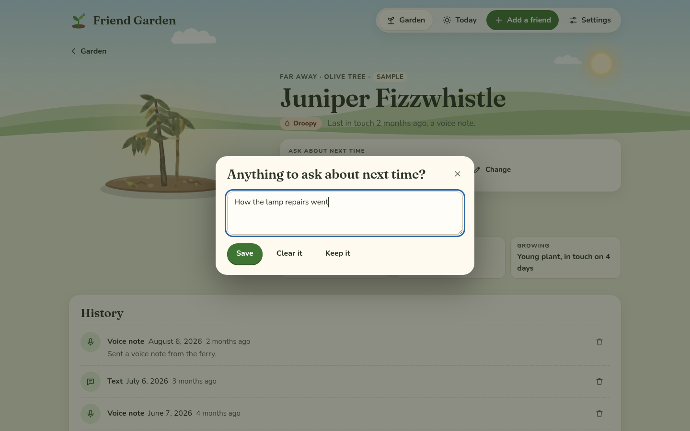
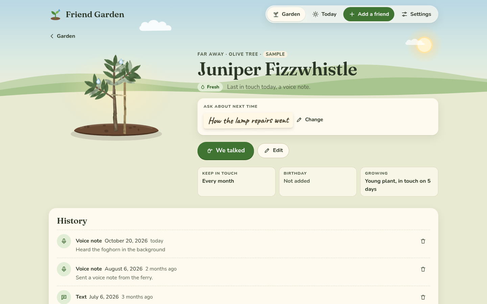

[Friend Garden docs](README.md) › Using Friend Garden

# Keeping in touch

This is the part you'll use most. **Today** tells you who'd love a hello, a friend's card is where you log it, and
the plant gets watered. None of it is meant to make you feel behind. There are no streaks, no red badges and no
"overdue", just plants that would like a drink.

## Today

The **Today** tab opens with a greeting and the date, and then three cards.

*Today: two people to say hello to, birthdays this week and the week so far.*

"Due for a hello" suggests two people, never a long list. The first is whoever has waited the longest, compared with
how often you wanted to be in touch. The second is one more, from a different group when there is one, which means
you don't get two cousins in a row. The second pick stays the same all day, so it doesn't jump around every time
you open the page. Each one shows when you were last in touch, their "Ask about" note, and a **We talked** button.
If more people are thirsty, a line under them says how many, with **See the thirstiest first**, which opens the
garden sorted by who's waited longest. When nobody's due, it says "Everyone is watered" and who's next.

"Birthdays this week" lists the birthdays in the next 7 days, with the day and how old they're turning when you
added the year. **Add birthdays to my calendar** downloads them all as a calendar file (see
[Your garden's data](your-data.md)). "This week" says how many people you were in touch with in the past 7 days,
with their plants. If it's nobody yet, it says there's plenty of time, because there is.

## We talked

Open someone's plant from the garden (or use the button on Today) and tap **We talked**.

*How, when, and a note if you like.*

- **How?** is **Call**, **Text**, **Visit**, **Letter** or **Voice note**. It starts on whatever you picked last
  time for that person.
- **When?** is **Today**, **Yesterday** or **Earlier**, which shows a date so you can log the call from last week.
- **A note** is optional, for what you talked about.

Tap **Water the plant**, and it asks "Anything to ask about next time?", with last time's note already in the box.
Change it, **Clear it**, or keep it the way it is with **Keep it** (or **Not now** when there wasn't one).

*The note for next time.*

Then a watering can comes out over the plant, tips, and the plant perks up. If it's been a few days in touch
already, it might grow a step, and the little message at the bottom says "It grew a little." For the next day or
so you'll see drops of water on its leaves.

*Watering. If your device is set to reduce motion, the plant just changes, with no animation.*

*Fresh again, and the visit is at the top of the history.*

## The card

A friend's card has their plant, big, with their group, the kind of plant, and how they're doing: **Fresh**,
**A bit thirsty** or **Droopy**, with when you were last in touch and how. "Ask about next time" is under that,
with **Change** to edit the note without logging a talk. At the bottom are the rhythm, the birthday and how far the
plant has grown.

*A friend's card.*

"History" lists every hello, newest first, with how, the date, how long ago and the note. The bin next to each one
removes it, after asking, in case you logged it by mistake. Removing hellos can make a plant thirstier again, but
it never makes it smaller, because growth only goes one way.

## The watering list

On a wide screen, a sheet of notebook paper is pinned beside the garden. It's the "Watering list": who'd love a
hello, thirstiest first, and the birthdays in the next two weeks. It's the same as Today in a glance, so you can
see it while you look at the garden.

## Getting around with a keyboard

Everything works with a keyboard. Tab moves between plants and buttons, Enter opens a plant, and Escape closes the
"We talked" window without logging anything. The garden also has a **List** view (next to "Garden" above the beds),
which is a plain list of everyone with their rhythm, their last hello and how they're doing, and it's the easiest
way through the garden with a screen reader.

## Next step

If you're curious why a plant looks the way it does, [The plants](the-plants.md) has every kind, every stage and
exactly when they get thirsty.

Next: [The plants](the-plants.md) →
