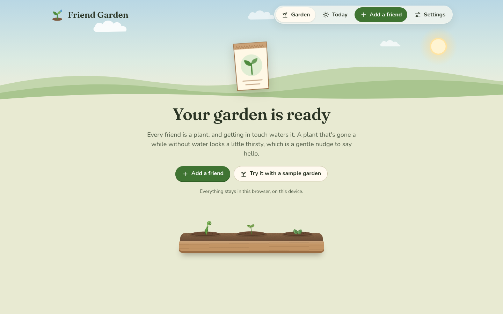
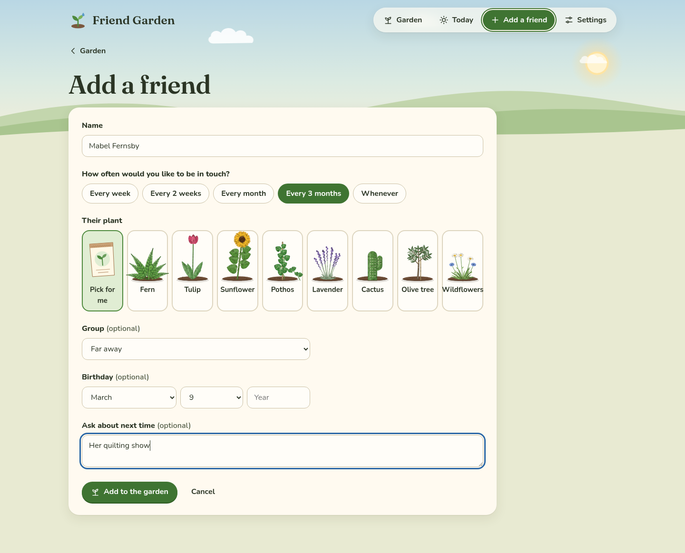

[Friend Garden docs](README.md) › Using Friend Garden

# Planting your garden

This page is about getting people into your garden: adding a friend, choosing how often you'd like to be in touch,
picking their plant, groups and birthdays. If you'd like to look around first, the sample garden at the end of the
page is the quickest way.

## The empty garden

The first time you open Friend Garden, the garden is empty and says "Your garden is ready", with two buttons:
**Add a friend** and **Try it with a sample garden**. Under them there's a little planter with three seedlings,
waiting.

*The first visit.*

## Adding a friend

Tap **Add a friend** (on a phone it's the green plus in the tab bar). The form has one thing you have to fill in,
the name, and everything else is optional or already has a sensible answer.

*Adding a friend. Only the name is needed.*

- **Name** is how they show up on their plant's tag. Something short reads best in the garden, like "Theo" or
  "Aunt Rosa", and the full name can go here too, it just gets cut off on the tag.
- **How often would you like to be in touch?** is the rhythm: **Every week**, **Every 2 weeks**, **Every month**
  (the default), **Every 3 months** or **Whenever**. This is what decides when the plant gets thirsty, which is
  explained in [The plants](the-plants.md). "Whenever" is for people you don't want any schedule for, and their
  plant only gets a bit thirsty after half a year.
- **Their plant** is one of eight kinds. **Pick for me** chooses a kind there's the least of in your garden, which
  keeps the garden mixed. You can change the plant later and it keeps its size.
- **Group** puts them in a bed. It starts with Family, Close friends and Far away, and **New group…** at the bottom
  of the list makes another one right there. **No group** puts them in "Everyone else".
- **Birthday** is a month and a day, and the year if you know it, which means Today can say "turns 34".
- **Ask about next time** is a note for your next talk, like "her new job" or "the trip to Lisbon".

Tap **Add to the garden** and you're back in the garden, where a seedling pops up in the right bed with their name
on the tag. If you forgot the name, it says "Add a name first." and if the birthday is a date that doesn't exist,
like February 30, it says so.

## Groups are beds

Each group is a planter in the garden with a wooden sign, and the planter is as long as it needs to be. At the end
of each one there's an **Add someone** spot, which opens the form with that group already picked. The order of the
beds, their names, and which ones there are, all live in **Settings** under "Groups": rename a group by typing in
its box, move it with the arrows, or remove it with the bin. When you remove a group, its plants move to "Everyone
else", so nobody gets lost.

## The sample garden

**Try it with a sample garden** plants twelve made-up people, like Captain Biscuit and Aunt Marmalade, with a few
months of history, so you can see every plant, every stage and every mood. A note at the top of the garden says
"This is a sample garden. Everyone in it is made up." and **Clear the sample** takes them away again. Anyone you
added yourself stays where they are, so it's fine to add your own people while the sample is still there.

## Changing or removing someone

Tap a plant to open their card, then **Edit**. It's the same form as adding, with **Save** at the bottom and
**Remove from the garden** on the right. Removing asks first, because their notes and history go too.

## Next step

Once a few people are planted, [Keeping in touch](keeping-in-touch.md) is about the part you'll do most: Today and
"We talked".

Next: [Keeping in touch](keeping-in-touch.md) →
