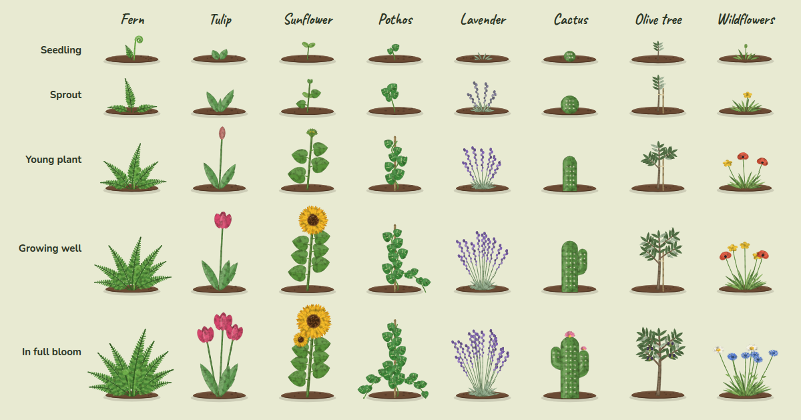
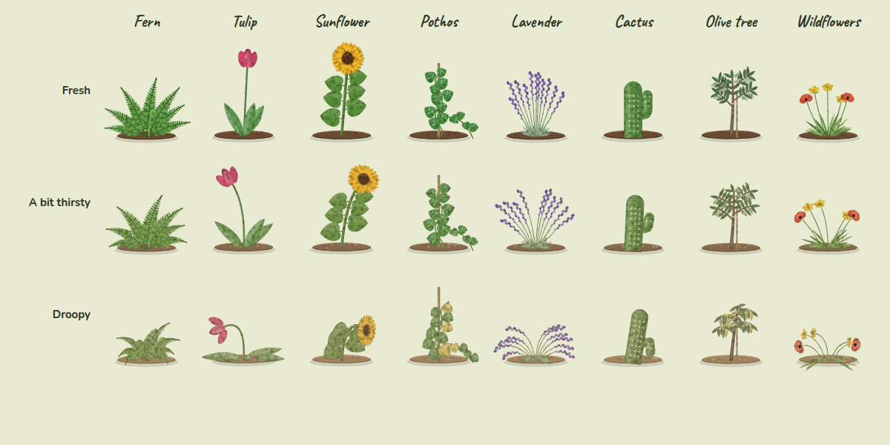
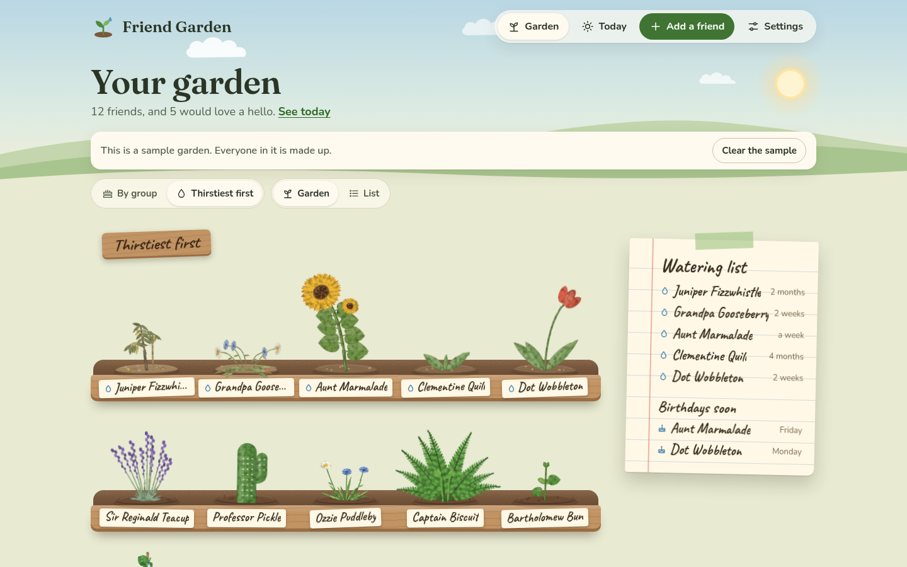
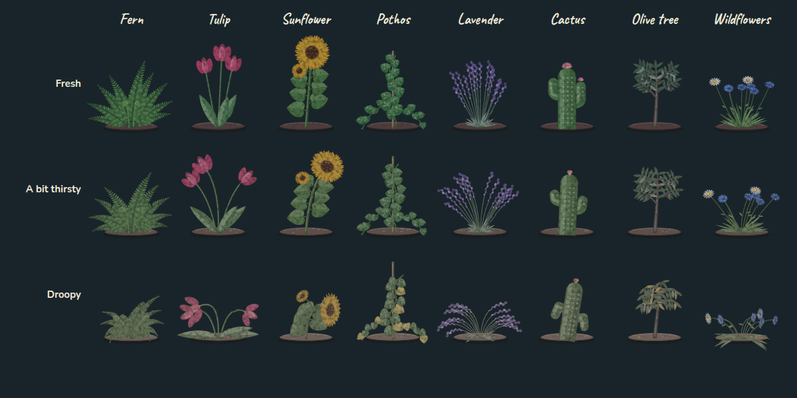

[Friend Garden docs](README.md) › Using Friend Garden

# The plants

The plants are the heart of Friend Garden, so this page is about them: the eight kinds, how they grow, and exactly
when they get thirsty. It's mostly a reference page, so there are tables.

## Eight kinds

Fern, tulip, sunflower, pothos, lavender, cactus, olive tree and wildflowers. They're drawn by the app itself, in
code, with a painted texture and slightly wobbly edges so they look hand-made. Each friend's plant has its own
shape, which means two ferns in the same garden aren't twins, and a plant keeps its shape from one day to the next.
It only changes when it grows or when it needs water.

*Every kind at every stage.*

The kind is just for fun and has nothing to do with the rhythm. A cactus for the friend you see twice a year is a
nice touch, but it's not a rule.

## How they grow

A plant grows a step as you keep in touch over the months. What counts is the number of different days you were in
touch, so three calls in one afternoon count once.

| Stage | Days in touch |
|---|---|
| Seedling | none yet |
| Sprout | 1 |
| Young plant | 3 |
| Growing well | 6 |
| In full bloom | 10 |

A plant NEVER shrinks. If you remove a hello from the history, the plant stays as big as it got. Its stage shows
on the card under "Growing", with how many days you've been in touch.

## When they get thirsty

Each friend's rhythm decides when their plant needs water. Once the time since your last hello reaches the rhythm,
the plant is a bit thirsty, and at twice the rhythm it's droopy. Someone you've just planted counts from the day you
added them.

| How often | A bit thirsty after | Droopy after |
|---|---|---|
| Every week | 7 days | 14 days |
| Every 2 weeks | 14 days | 28 days |
| Every month | 30 days | 60 days |
| Every 3 months | 91 days | 182 days |
| Whenever | 180 days | never |

*Fresh, a bit thirsty and droopy.*

You can see it in the plant: a bit thirsty leans a little and goes a shade paler, and droopy hangs its leaves and
flowers, turns yellow at the edges, and the soil dries out and cracks. On a computer, a thirsty plant also gets a
small drop on its name tag, and its card says **A bit thirsty** or **Droopy**. That's as loud as it gets. A plant
never dies, however long it's been, and one hello makes it fresh again. For a day or so after you water it, there
are drops of water on its leaves.

*"Thirstiest first" puts everyone in one long planter, in order of who's waited the longest.*

## The garden at dusk

When your device is in dark mode, the garden is the same garden an hour after sunset: a purple sky with a moon and
stars, the plants in evening colors, and fireflies drifting over the beds. **Settings** has a "Look" choice of
**Automatic**, **Day** or **Dusk** if you'd rather pick one yourself.

*The plants at dusk.*

If your device is set to reduce motion, the plants hold still, the clouds and fireflies stop, and watering happens
without the watering can.

## Next step

Now that your garden is growing, [Your garden's data](your-data.md) is worth a read, mostly for the backup.

Next: [Your garden's data](your-data.md) →
