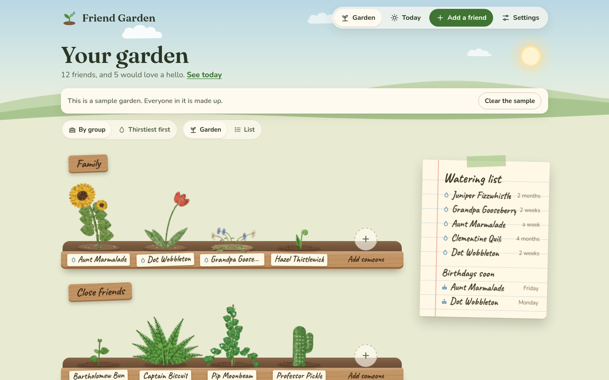
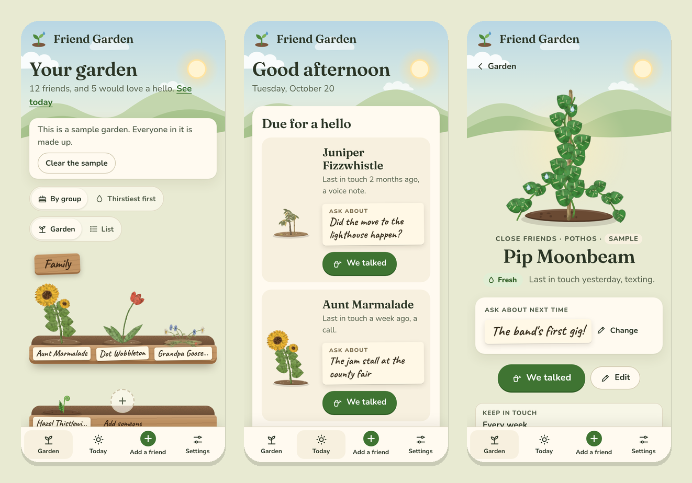

[Friend Garden docs](README.md) › Getting started

# What is Friend Garden?

Friend Garden is a web page that helps you keep in touch with the people you love. Every friend is a plant in your
garden, and getting in touch waters it. A plant that's gone a while without water starts to look a little thirsty,
which is the whole reminder. It never dies, it never scolds you, and it doesn't count streaks.

*The garden on a computer. Each group is a planter, and each friend is a plant with their name on the front.*

## What it does

You add the people you want to stay close to, and for each one you say how often you'd like to be in touch: every
week, every 2 weeks, every month, every 3 months, or "whenever". Each friend gets a plant, one of eight kinds, all
drawn by hand. When that much time goes by without a hello, the plant gets a bit thirsty, and if it goes twice as
long it gets droopy.

When you talk to someone, you open their plant and tap **We talked**. You say how (a call, a text, a visit, a
letter or a voice note), add a note if you like, and then it asks "Anything to ask about next time?", which is
where the new job or the trip goes so you remember it next time. A watering can tips over the plant and it perks
up. Over the months, the more often you're in touch, the more the plant grows, from a seedling to full bloom.

The **Today** page picks two people for a hello, shows the birthdays in the next week, and tells you how many
people you were in touch with this week. Basically, instead of trying to remember who you haven't called in ages,
you look at your garden and it tells you.

## Who it's for

Anyone who has ever realized it's been a year since they talked to someone they really like. It works just as well
for five people as for fifty, and for family as much as friends. If you're the organized type, the groups and the
birthday calendar are there for you, and if you're not, you can just add people and tap **We talked** now and then.

*On a phone: the garden, Today and a friend's card.*

## Where it works

Friend Garden is one web page, so it's the same everywhere: on a phone, a tablet or a computer, in any up-to-date
browser. On a phone it has tabs at the bottom, and on a computer they're at the top. You can add it to your Home
Screen and it opens like an app, and once it has loaded it works without the internet.

It follows your device's light or dark setting. In light mode it's a garden by day, and in dark mode it's the same
garden at dusk, with fireflies. You can also pick one yourself in **Settings**, under "Look".

## What stays on your device

EVERYTHING you put in it. There's no account and no sign-in, and Friend Garden has no server of its own to send
anything to. The names, notes, birthdays and history you add are kept in your browser's storage on that device, and
they never leave it unless you download a backup yourself.

This also means your garden doesn't move between devices by itself. A garden on your phone isn't on your computer,
and clearing the site's data in your browser clears your garden too. That's what **Download a backup** in Settings
is for, and [Your garden's data](your-data.md) explains it.

## Next step

Open **https://stuffs.tiresia.xyz/friend-garden/** and tap **Try it with a sample garden** to see how it looks after
a few months, or go straight to [Planting your garden](planting.md) to add your first friend.

Next: [Planting your garden](planting.md) →
