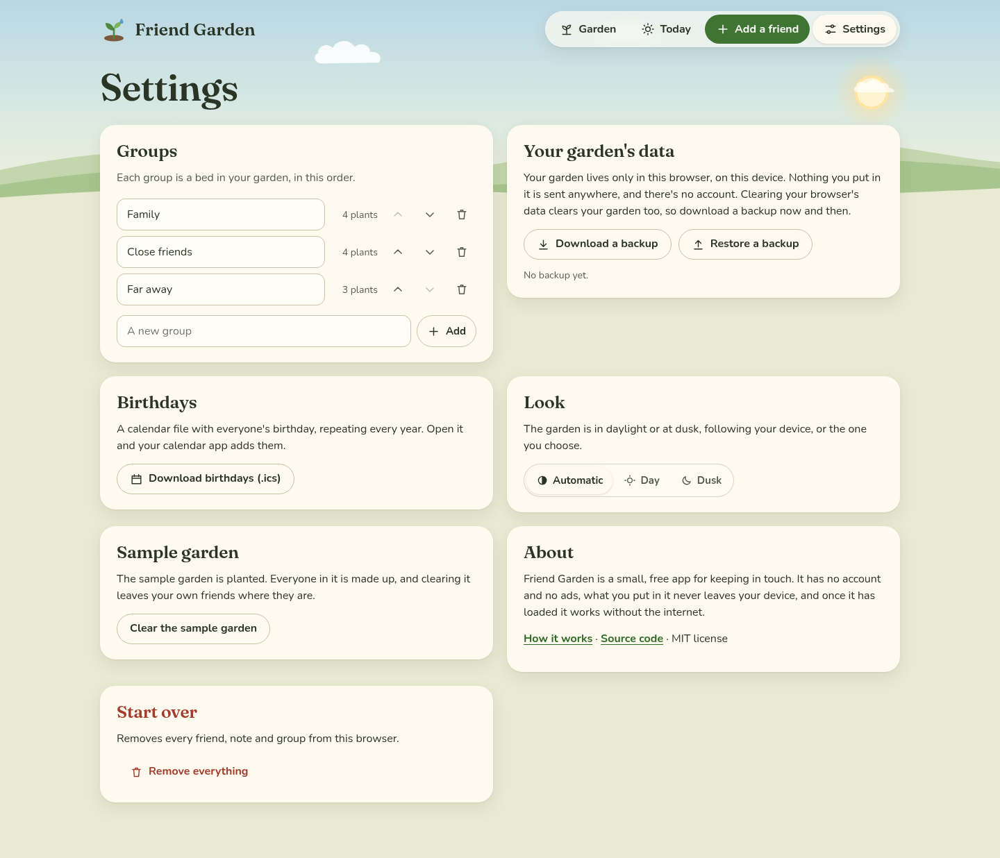

[Friend Garden docs](README.md) › Your data

# Your garden's data

This page is about where your garden lives, how to keep a copy of it, and the other things in **Settings**: the
birthday calendar, the look, the sample garden and starting over.

*Settings.*

## Where it lives

Your garden lives only in your browser, on that device. There's no account and no server, and nothing you type is
sent anywhere, which means nobody else ever sees who your friends are. The flip side is that it's up to you to keep
a copy. Clearing your browser's data for the site (or "clear history and website data" on an iPhone) clears your
garden too, and a garden on your phone doesn't show up on your computer.

In a private window, or anywhere the browser won't keep anything, Friend Garden still works, and a note says the
garden lasts only until you close the tab.

## Backups

**Download a backup** saves your whole garden as one small file, named with the date, like
`friend-garden-backup-2026-10-20.json`. It has everyone, their notes, birthdays, history and your groups. Settings
then shows when you last made one. I'd do it every month or so, and before you clear your browser or switch phones.

**Restore a backup** opens a file you downloaded before. It tells you how many friends are in it and asks first,
because it REPLACES what's in your garden now. This is also how you move a garden to another device: download a
backup on one, send yourself the file, and restore it on the other. If the file isn't a Friend Garden backup, it
says so and doesn't touch anything.

## Birthdays in your calendar

**Download birthdays (.ics)** in Settings (or **Add birthdays to my calendar** on Today) makes one calendar file,
`birthdays.ics`, with everyone's birthday as an all-day event that repeats every year, called "Name's birthday".
Open it and your calendar app offers to add them: on an iPhone, tap the file and **Add All**, and in Google Calendar
use **Import** in the settings. A February 29 birthday shows up on February 28 in the years without one.

The calendar file is a copy, so a birthday you add or change later needs a new download.

## On your Home Screen

On an iPhone or iPad, open Friend Garden in Safari, tap the **Share** button, then **Add to Home Screen**. On Android,
the browser menu has **Add to Home screen** or **Install app**. It opens full screen with its own icon, and after
the first time it works without the internet.

One thing to know: on an iPhone or iPad, the Home Screen copy keeps its own storage, separate from Safari's. So a
garden you planted in Safari won't be in the Home Screen copy. Pick one and stick with it, or move the garden over
with a backup.

## Look, sample garden and starting over

- **Look** is **Automatic** (following your device), **Day** or **Dusk**.
- **Sample garden** plants the twelve made-up people, or clears them, leaving your own friends where they are.
- **About** has links to these docs and the source code.
- **Start over** has **Remove everything**, which removes every friend, note and group from this browser after
  asking. A backup file you downloaded stays where it is, so you can always restore it.

## Next step

Download your first backup now, so you know where the file goes on your device. If something doesn't work the way
these pages say, open an issue on the GitHub repo and tell me what happened.
